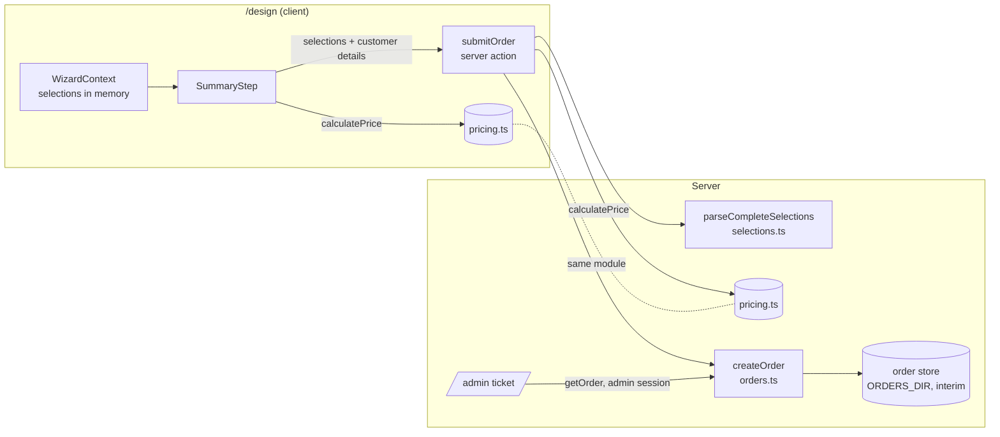

# Design: wizard flow, pricing and order submission

This design implements `requirements.md`. It builds on code that already exists. Most of the flow
is already in place; the new parts are pricing, completeness checks on the server, the order
record and order submission.

## Overview



`pricing.ts` and `selections.ts` are plain TypeScript modules. They import only config, so the same
code runs in the browser bundle and on the server.

## What already exists (verified against the code)

| Requirement | Existing implementation | Status |
|---|---|---|
| 1 Step order | `designSteps` and `wizardSteps` in `src/config/steps.config.ts`; `measurementSteps` in `src/config/measurements.config.ts`. The order matches requirement 1.1 exactly. | Done |
| 1.4–1.6 Navigation | `next`, `back` and `goTo` in `WizardContext.tsx` use `activeSteps()` and `isStepComplete()`. | Done |
| 1.7 Screen 25 SUBMIT | `TailorNoteStep` calls `onNext`. | Done |
| 2 Waistcoat | `conditionalSteps.waistcoat = { step: "jacketStyle", option: "threePiece" }`; the `select` reducer clears inactive conditional steps. | Done (client) |
| 3 Pants branch | `conditionalSteps.pantsFabric`; `FabricPicker` with target `pantsFabric`; `effectivePantsFabric()` in `src/lib/selections.ts`. | Done (client) |
| 4 Measurements | 15 `measurementFields`, 13 screens, `parseMeasurement()`, the `saveMeasurements` reducer (all or nothing), thigh `illustrationPending`. | Done |
| 2.4, 3.7, 10 Server validation | `parseSelections()` checks ids, ranges and conditional rules, but accepts **incomplete** selections. | Partial |
| 6–8 Pricing | Deltas are in config (`basePrice`, `priceDelta`, `monogramStep.priceDelta`). No sum exists; the summary shows the placeholder `summaryCopy.pricePlaceholder` ("AED —"). | Missing |
| 9 Submission | Nothing writes orders. | Missing |
| 11 Ticket | `/admin` with `getOrder()`, `SummaryGrid variant="ticket"`, `ticketCopy.codeNotOnFile`. `ProductionOrder` has no pricing field. | Done; must accept the new record format |

## Components and interfaces

### 1. Shared step rules: `src/lib/selections.ts` (extended)

Today `isStepActive()`, `activeSteps()` and `isStepComplete()` are private to `WizardContext.tsx`,
which is a `"use client"` module. The server needs the same completeness rule, so they move to
`src/lib/selections.ts` unchanged. `WizardContext.tsx` imports them, and its behaviour doesn't change.

```ts
export function isStepActive(step: WizardStepId, selections: WizardSelections): boolean;
export function activeSteps(selections: WizardSelections): WizardStepId[];
export function isStepComplete(step: WizardStepId, selections: WizardSelections): boolean;

/** True when every shown step except the summary is complete (requirement 4.6). */
export function isCompleteSelections(selections: WizardSelections): boolean;

/**
 * parseSelections() + isCompleteSelections() + normalisation: drops monogramStyle when
 * monogramText is empty (assumption A4). Returns null if anything is invalid or incomplete.
 */
export function parseCompleteSelections(raw: unknown): WizardSelections | null;
```

`isCompleteSelections` is `activeSteps(s).filter((st) => st !== "summary").every((st) => isStepComplete(st, s))`.
For the measurement steps that already means all 15 fields are saved. `parseSelections()` already
enforces the conditional rules (requirements 2.4 and 3.7).

### 2. Pricing: `src/lib/pricing.ts` (new)

```ts
export class PricingError extends Error {}

/**
 * Total in AED, VAT excluded (spec §7). Pure; amounts come only from config.
 * Throws PricingError if a price-relevant choice is missing or unknown.
 */
export function calculatePrice(selections: WizardSelections): number;

/** "AED 1267.00": currency, space, two decimals, no thousands separator (screen 26). */
export function formatPrice(amount: number): string;
```

Algorithm. Every lookup throws `PricingError` if the id isn't found.

```
family   = fabricFamilies[selections.fabric.family]
swatch   = family.swatches[selections.fabric.swatch]
total    = family.basePrice + swatch.priceDelta
total   += optionSteps.jacketStyle[selections.jacketStyle].priceDelta
if jacketStyle == "threePiece":  total += optionSteps.waistcoat[selections.waistcoat].priceDelta   (required)
else if selections.waistcoat set: throw                                     (stale waistcoat)
if pantsFabricChoice == "yes":   total += pantsSwatch(selections.pantsFabric).priceDelta          (required; family base NOT added)
else if pantsFabricChoice == "no" and pantsFabric set: throw
else if pantsFabricChoice missing: throw
total   += optionSteps.waistband[selections.waistband].priceDelta
total   += optionSteps.cuff[selections.cuff].priceDelta
if (selections.monogramText ?? "") != "": total += monogramStep.priceDelta
return total
```

- Steps with no price term (fit, lapels, vent, pants fit, rise, note, measurements) are not read.
  Their options all have `priceDelta: 0` today. If a non-zero delta is ever added to them, it is
  ignored until the spec formula is changed. That is deliberate: the formula is the spec's, not
  "sum every delta".
- `formatPrice` is `` `${priceCurrency} ${amount.toFixed(2)}` ``, the same format as
  `formatBasePrice` in `fabrics.config.ts`. That function stays as it is; no refactor.
- Amounts are integers (A3), so floating-point rounding can't occur.

#### Worked examples (hand-computed from the current config)

These are the expected results for Prompt 17's tests.

| # | Selections (price-relevant only) | Sum | Total |
|---:|---|---|---:|
| E1 | Base: Polyester Blend / Midnight Navy, 2-Piece, pants NO, Belt Loops, Without cuff, no monogram | 699 + 0 + 0 + 0 + 0 | **699** |
| E2 | +99 swatch and Side Tabs: Wool / Navy Pinstripe, 2-Piece, pants NO, Side Tabs, Without cuff | 799 + 99 + 0 + 59 + 0 | **957** |
| E3 | Different pants fabric: Linen / Ivory, Tuxedo, pants YES Wool / Navy Pinstripe, Belt Loops, Without cuff | 999 + 0 + 299 + 99 + 0 + 0 | **1397** |
| E4 | Monogram: E1 + monogram "AB" (any style) | 699 + 39 | **738** |
| E5 | Screen 26: Velvet / Deep Burgundy, Safari, pants YES Polyester Blend / Midnight Navy, Side Tabs, With cuff | 899 + 0 + 299 + 0 + 59 + 10 | **1267** |
| E6 | Everything: Wool / Navy Prince of Wales Check, 3-Piece, Double-Breasted waistcoat, pants NO, Side Tabs, With cuff, monogram | 799 + 99 + 199 + 29 + 59 + 10 + 39 | **1234** |
| E7 | Pants NO does not repeat the jacket delta: Wool / Navy Pinstripe, 2-Piece, pants NO, Belt Loops, Without | 799 + 99 | **898** |
| E8 | Pants family adds no base: Polyester Blend / Midnight Navy, 2-Piece, pants YES Linen / Ivory, Belt Loops, Without | 699 + 0 + 0 + 0 | **699** |
| E9 | Error: 2-Piece with a waistcoat set | — | `PricingError` |
| E10 | Error: 3-Piece with no waistcoat | — | `PricingError` |

### 3. Summary total: `src/components/wizard/SummaryStep.tsx` (changed)

`PriceBlock` renders `formatPrice(calculatePrice(selections))` in place of
`summaryCopy.pricePlaceholder`. The visible span is no longer `aria-hidden`, and the `sr-only`
placeholder label is removed. The classes, sizes and positions stay the same.
`summaryCopy.pricePlaceholderLabel` is deleted. `summaryCopy.pricePlaceholder` ("AED —") stays as
the fallback below.
If `calculatePrice` throws, the block keeps showing "AED —" so the page doesn't crash (requirement
8.3). NEXT can't reach the summary
with incomplete selections; the exposed but unused `goTo()` could.

### 4. Order record and store: `src/server/orders.ts` (extended)

```ts
export type OrderRecord = {
  schemaVersion: 1;
  id: string;                  // crypto.randomUUID(); matches isOrderId()
  status: "submitted";
  submittedAt: string;         // server time, ISO 8601
  customerName: string;        // trimmed, 1-100 chars
  customerEmail: string;       // trimmed, lower-cased, <= 254 chars
  selections: WizardSelections; // parseCompleteSelections() output, incl. the 15 measurements
  pricing: { total: number; currency: "AED"; vatIncluded: false };
};

/** Writes a new order. Only the submission action calls this. */
export async function createOrder(record: OrderRecord): Promise<{ status: "notConfigured" } | { status: "ok" }>;
```

- **Interim store.** The interim store writes `<ORDERS_DIR>/<id>.json` atomically: it writes
  `.<id>.tmp`, then renames it. `listOrders()` ignores the `.tmp` file because it reads only `*.json`.
  `createOrder` doesn't require an admin session, because it is the public write path. It is not
  exported from any client-reachable module, and only the server action imports it.
- **Production store (open, Q3).** The interim store is for development only: Vercel's file system is
  read-only. The production store or notification (database, email or WhatsApp) replaces the
  internals of `createOrder`, `listOrders` and `getOrder`, and their signatures stay the same.
- **Reading.** `parseOrder()` accepts records with `schemaVersion: 1`. It validates `customerEmail`
  and uses `parseCompleteSelections()`. `ProductionOrder`, the type the ticket receives, stays
  `{ id, customerName, submittedAt, selections }`. `pricing` and `customerEmail` are dropped while
  parsing, so they never reach the ticket (requirement 11.3).
- **Legacy test files.** Records without `schemaVersion` were only ever used as test fixtures (no
  real orders exist). They are rejected as invalid.

### 5. Submission: `app/design/actions.ts` (new, `"use server"`)

```ts
export type SubmitOrderInput = { selections: unknown; customer: { name: unknown; email: unknown } };
export type SubmitOrderResult =
  | { ok: true; orderId: string }
  | { ok: false; error: "invalidOrder" | "invalidCustomer" | "unavailable" };

export async function submitOrder(input: SubmitOrderInput): Promise<SubmitOrderResult>;
```

1. `parseCompleteSelections(input.selections)`. If it returns null, the result is `invalidOrder`.
2. Validate the customer details. Name: a trimmed string of 1–100 characters. Email: a trimmed
   string of at most 254 characters matching `^[^\s@]+@[^\s@]+\.[^\s@]+$`. If either fails, the
   result is `invalidCustomer`.
3. `total = calculatePrice(selections)`. A `PricingError` gives `invalidOrder`. It can't happen after
   step 1, but it is guarded.
4. Build the `OrderRecord` with `crypto.randomUUID()` and the server's `new Date().toISOString()`.
5. `createOrder(record)`. `notConfigured` or a write error gives `unavailable`. Nothing is partially
   written, because of the temp file and rename.
6. Return `{ ok: true, orderId }`. The client then navigates to `/order/<id>/confirmation` and calls
   `clearAll()`.

Server actions are public endpoints, so every input is treated as untrusted. No price, total or
delta is read from the input. The body is limited by Next's default server-action size limit (1 MB).
Rate limiting is Q12.

### 6. Submit UI and confirmation (blocked on Q1 and Q2)

- **Submit control.** Screen 26 has no submit control. Its place, label and look, and the
  customer-details fields, need an approved design. The client side is ready: `submitOrder`,
  `useTransition` to disable the control while pending (requirement 9.8), errors shown inline, and
  the selections kept on failure.
- **Confirmation page.** It lives at `app/order/[id]/confirmation/page.tsx`. It checks the id with
  `isOrderId` and shows only an "order received" message and the id. It doesn't read the store, so it
  can't reveal whether an order exists or what it contains (requirement 9.10). Its copy and design
  aren't in the deck (Q1).

### 7. Admin ticket (no visual change)

`app/admin/page.tsx` keeps using `getOrder()` and `SummaryGrid`. The only change is in `orders.ts`
parsing (section 4). Authentication (`admin-auth.ts`), the Suspense and `connection()` setup, and
the "CODE NOT ON FILE" fallback stay unchanged.

## Data mapping (order record to spec §6 `Order`)

| Spec §6 field | Order record | Note |
|---|---|---|
| `id` | `id` | UUID |
| `user_id` | `customerName`, `customerEmail` | No accounts in v1 (A5) |
| `status` | `status` | `submitted` only in v1 |
| `jacket_fabric_swatch_id` | `selections.fabric` `{family, swatch}` | Swatch ids are unique per family |
| `jacket_style_id`, `jacket_fit`, `lapel_thickness`, `lapel_style`, `back_vent` | `selections.jacketStyle`, `jacketFit`, `lapelThickness`, `lapelStyle`, `backVent` | Config option ids |
| `waistcoat_style` (null unless 3-Piece) | `selections.waistcoat` (absent unless `threePiece`) | Requirement 2 |
| `pants_fabric_swatch_id` (null = same as jacket) | `selections.pantsFabricChoice` + `selections.pantsFabric` (absent after NO) | Requirement 3 |
| `pants_fit`, `pants_rise`, `waistband`, `cuff` (bool) | `selections.pantsFit`, `rise`, `waistband`, `cuff` (`"with"` / `"without"`) | `cuff` is an option id, not a bool |
| `monogram_text`, `monogram_style` | `selections.monogramText`, `monogramStyle` | Requirement 5 |
| `tailor_note` | `selections.tailorNote` | |
| `measurement_profile_id` (snapshot) | `selections.measurements` (15 values, copied) | Requirement 4.7 |
| `total_price`, `currency` | `pricing.total`, `pricing.currency`, plus `pricing.vatIncluded: false` | Requirement 7 |
| `created_at`, `submitted_at` | `submittedAt` | No drafts in v1, so both are the same |

## Error handling

| Situation | Behaviour |
|---|---|
| Incomplete or invalid selections sent to `submitOrder` | `invalidOrder`; nothing stored |
| Missing or invalid name or email | `invalidCustomer`; nothing stored |
| `ORDERS_DIR` unset, not absolute or not writable | `unavailable`; nothing stored; the wizard keeps the selections |
| `calculatePrice` throws on the summary | Shows "AED —" (only reachable through `goTo()`, which no UI calls) |
| A stored record fails validation | The ticket shows "ORDER NOT FOUND" (unchanged) |
| Double click on submit | The control is disabled while pending; each completed call creates one order |

## Security

- Prices are computed on the server only, from config; client totals are ignored (spec §7).
- `orders.ts` stays `server-only`, and reads still call `requireAdminSession()`.
- Order ids are random UUIDs and pass `isOrderId()` before any file path is built.
- The confirmation page shows only the id. Contact details and measurements never leave the server
  except on the authenticated ticket, and the ticket doesn't show contact details either.

## Testing strategy

- **Prompt 17 (separate prompt).** Unit tests for `calculatePrice()` using examples E1–E10. No test
  runner is installed, so Prompt 17 has to choose one, which adds a dependency it needs approval for.
  This spec adds no tests.
- **Per task.** Run `npx tsc --noEmit -p .`, `npm run lint` and `npm run build`. Then walk the wizard
  in the browser and compare against screens 26 and 27.
- **Submission (task 6).** Call the action from a temporary, uncommitted test route against a
  temporary `ORDERS_DIR`, and delete the route afterwards. Check that the stored record matches
  `OrderRecord`, that a tampered client total has no effect, and that the order appears on `/admin`.
